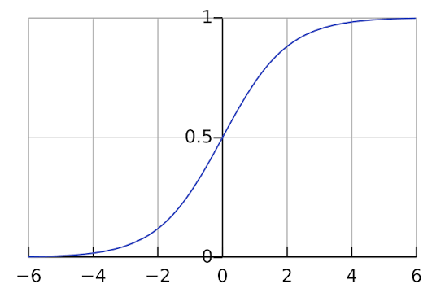

Last updated: Oct 30, 2026最後更新：2026年10月30日

<a href="../">Assignments作業</a> · <a href="../../">CHI 3242 syllabusCHI 3242 課程大綱</a>

<h1 class="i18n-block">Assignment 2: Train Your Own Text Classifier作業2：訓練自己的文本分類器</h1>

<strong>Due:</strong> 11 Nov, 9:00 am

In this course we have learned how to train our own logistic regression classifier to estimate the sentiment of a text (positive versus negative). This way we operationalized Kurt Vonnegut's argument about the Shapes of Stories. In this assignment, you are asked to choose a <strong>binary</strong> problem of your own: a question that can be answered by assigning one of two labels to a piece of text. It can be positive versus negative sentiment, embodied versus abstract language, Cao Xueqin versus Gao E (authorship), or any other distinction that interests you. Define what each label means, prepare and label your own training data, and train a logistic regression classifier using the methods from class.

Having trained the model, use it on another text of your choice. Report how well it works, look at where it goes wrong, and say what its predictions tell you about that text.

On Moodle, submit two things: the URL of one public GitHub repository and a PDF of your report. The core deliverables are the <strong>PDF report</strong>, your <strong>data</strong>, and your <strong>code</strong>; everything needed to understand and reproduce your analysis should live inside the repository. Do not include your name or student ID in the public repository. The repository must include:

<ul>
<li><code>README.md</code> (your research question, label definitions, the source and sampling method for each dataset, and instructions for running your code)</li>
<li><code>data/</code> (your labeled training data in a clear, documented format, such as a CSV with one text item and one label per row; include the separate text you analyze if you are permitted to share it)</li>
<li>Python script(s) (<code>.py</code>) for preparing the data, splitting it, training and evaluating the model, and applying it to your analysis text</li>
<li><code>output/</code> (the test-set predictions and evaluation results, plus the predictions for your analysis text)</li>
<li><code>report.md</code> <strong>and</strong> <code>report.pdf</code> (the same short report in both formats), <strong>2,000–2,500 characters</strong>. Submit the PDF separately on Moodle as well. The PDF should not just be a raw export of the Markdown; format it so it looks clean and tidy, with no Markdown syntax showing.</li>
<li>Optional: an <strong>interactive analysis page</strong> (a GitHub Pages site, as you have built before) that uses your trained model to visualize the predictions on your analysis text and lets a reader explore the results in detail.</li>
</ul>

<strong>Method requirements:</strong>

<ul>
<li>Choose a <strong>binary</strong> task with two clearly defined labels.</li>
<li>Pick a consistent unit (sentence, review, post, or paragraph) and explain your labeling rules.</li>
<li>Prepare at least <strong>200 labeled items per class</strong> (more is better), keeping the two classes reasonably balanced; you may use AI to help label, but check a sample yourself; AI labels can be wrong.</li>
<li>Split the data into training (80%) and test (20%) sets before fitting, stratified by label with a fixed random seed.</li>
<li>Train a <code>LogisticRegression</code> classifier. Think about your features: frequencies of the most common 200 words? TF-IDF values? z-scores?</li>
<li>Evaluate on the test set: accuracy, confusion matrix, precision, recall, and F1.</li>
<li>Apply the model to a separate text of your choice and show the predicted labels (and probabilities if useful).</li>
<li>Optional: build an interactive GitHub Pages page to explore the results.</li>
</ul>

The <strong>report</strong> (2,000–2,500 characters) should read as a short, well-argued essay rather than a checklist. Introduce your question and explain why the distinction matters for the text you chose. Describe your labels, data sources, sampling, and preparation; explain the train/test split and the text features used by the classifier. Present your test-set results, including accuracy and the confusion matrix, and interpret the errors: which items were misclassified, what patterns or ambiguities do they share, and what might explain the mistakes? Then analyze the predictions on your separate text. What patterns do they suggest? Where should you be cautious about taking the model’s labels at face value? Conclude by reflecting on the limits of your data, labels, and model, and what you would change with more time or data.

You may use AI to help with coding or writing, but the report must present your own individual analysis and interpretation. A report that is fully AI-generated will receive <strong>0 points</strong>. If there is any doubt, the instructor may ask you individually to explain your workflow and results to confirm that you understand your analysis.

You may work alone or in a group of up to <strong>3 people</strong>. If you work in a group, submit one repository and one report for the whole group. List all members' names only in the Moodle upload; names should not appear in the repository.

<strong>截止：</strong>11月11日 上午9:00

在課程中，我們已經學過如何訓練自己的邏輯迴歸分類器，來估計一段文本的情感（正面或負面）。這樣一來，我們把 Kurt Vonnegut 關於「故事形狀」（Shapes of Stories）的論點操作化了。這次作業請你自選一個<strong>二元</strong>問題：一個可以透過替文本指定兩種標籤之一來回答的問題。可以是正面／負面情感、具體／抽象語言、曹雪芹／高鶚（作者歸屬），或任何你感興趣的區分。請定義每個標籤的意義，準備並標註自己的訓練資料，然後運用課堂所學的方法訓練邏輯迴歸分類器。

訓練好模型之後，請把它用在另一段你自選的文本上。報告它的表現如何、看看它在哪裡出錯，並說明它的預測對這段文本說明了什麼。

請在 Moodle 提交兩項：一個公開 GitHub 倉庫的網址，以及報告的 PDF 檔。核心交付物是<strong>PDF 報告</strong>、你的<strong>資料</strong>與<strong>程式碼</strong>；所有理解與重現分析所需的東西都應放在倉庫裡。公開倉庫中請勿放入姓名或學號。倉庫須包含：

<ul>
<li><code>README.md</code>（研究問題、標籤定義、各組資料的來源與取樣方式，以及執行程式碼的方法）</li>
<li><code>data/</code>（格式清楚且有說明的標註訓練資料，例如每列一筆文本及其標籤的 CSV；若獲准公開，也請放入用來分析的另一組文本）</li>
<li>用於準備資料、切分資料、訓練與評估模型，以及分析自選文本的 Python 腳本（<code>.py</code>）</li>
<li><code>output/</code>（測試集預測與評估結果，以及自選文本的預測）</li>
<li><code>report.md</code> <strong>與</strong> <code>report.pdf</code>（同一篇短報告的兩種格式），<strong>2,000–2,500字</strong>。PDF 另外也要在 Moodle 提交。PDF 不應只是 Markdown 的直接匯出，請排版整齊，不要出現 Markdown 編輯符號。</li>
<li>可選：一個<strong>互動式分析頁面</strong>（GitHub Pages 網站，如同你之前做過的），使用你訓練好的模型視覺化自選文本的預測結果，讓讀者可以深入探索細節。</li>
</ul>

<strong>方法要求：</strong>

<ul>
<li>選擇一個<strong>二元</strong>任務，定義兩個清楚的標籤。</li>
<li>選定一致的文本單位（句子、評論、貼文或段落），並說明標註規則。</li>
<li><strong>每一類至少準備200筆</strong>標註文本（越多越好），兩類數量盡量平衡；可以用 AI 協助標註，但請自行抽樣檢查；AI 標註可能出錯。</li>
<li>先將資料切分為訓練集（80%）與測試集（20%），按標籤分層並設定固定隨機種子。</li>
<li>訓練 <code>LogisticRegression</code> 分類器。請思考你的特徵：是最常見200個詞的詞頻？TF-IDF 值？還是 z-score？</li>
<li>在測試集上評估：準確率、混淆矩陣、精確率、召回率與 F1。</li>
<li>把模型用在另一段自選文本上，呈現預測標籤（若有幫助也可呈現機率）。</li>
<li>可選：建立互動式 GitHub Pages 頁面來探索結果。</li>
</ul>

<strong>報告</strong>（2,000–2,500字）應該是一篇論證清楚的短文，而不是條列式的檢查清單。請介紹你的問題，並說明為何這項區分對所選文本很重要。描述標籤、資料來源、取樣與處理方式，並解釋訓練／測試切分及分類器使用的文本特徵。呈現測試集結果，包括準確率與混淆矩陣，並詮釋錯誤：哪些文本被錯誤分類？它們有何共同模式或歧義？可能的原因是什麼？接著分析分類器對另一組文本的預測。這些結果顯示了什麼模式？為什麼不應全盤接受模型的標籤？最後，請反思資料、標籤與模型的限制，以及若有更多時間或資料，你會如何改進。

你可以使用人工智能協助撰寫程式或報告，但報告必須呈現你個人的分析與詮釋。若報告完全由人工智能生成，將獲得<strong>0分</strong>。如有疑慮，教師可能會個別要求你解釋工作流程與結果，以確認你理解自己的分析。

你可以單獨完成，也可以組成最多<strong>3人</strong>的小組合作。若以小組進行，請全組提交一個倉庫與一份報告。所有成員姓名只列在 Moodle 上傳中；姓名不應出現在倉庫裡。

