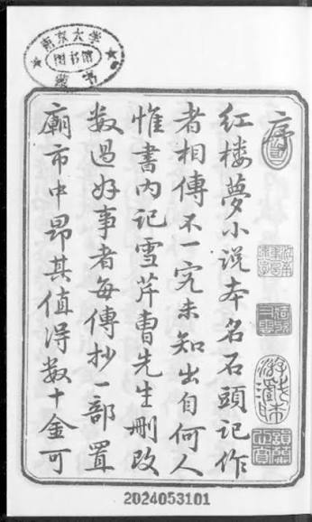

Last updated: Oct 12, 2026

<a href="../../">DHG 502 syllabus</a>

<h1>Week 6 — OCR with a Vision–Language Model</h1>

OCR (optical character recognition) turns a page image into text. Instead of a dedicated OCR engine, we send the image to a <strong>vision–language model</strong> through the OpenRouter API and ask it to transcribe the page.

<h2>1. Get the image</h2>

Download the test page (a woodblock-printed page of the <em>Hongloumeng</em> 紅樓夢, vertical classical Chinese) and put it in your <code>dhg502</code> repo:

<a href="hongloumeng.jpeg" download>hongloumeng.jpeg</a>

<ul>
<li><strong>(a) Local:</strong> right-click → <strong>Save Image As…</strong>, then drag it into the repo folder in VS Code.</li>
<li><strong>(b) Browser (Codespaces):</strong> save it to your computer, then drag it into the file explorer on the left.</li>
</ul>

<h2>2. Choose a model</h2>

The model must accept <strong>images</strong>. Use one of the Qwen models:

<ul>
<li>Qwen3.5-9B (<code>qwen/qwen3.5-9b</code>), our default</li>
<li>Qwen3.7 Flash</li>
<li>Qwen3.8 Flash</li>
</ul>

Experiment: run the same page with each model and compare the results. To switch, copy the model ID from its <a href="https://openrouter.ai/models">OpenRouter</a> page into <code>ocr.py</code>. Keep reasoning <strong>off</strong>.

<h2>3. In-class exercise</h2>

Open your repo in your AI coding assistant (for example VS Code with Copilot, OpenCode, or any other you set up in Week 1) and paste:

Prompt 1

<pre>Write a simple Python script ocr.py that does OCR on hongloumeng.jpeg using the OpenRouter API.

- Endpoint: https://openrouter.ai/api/v1/chat/completions
- Model: qwen/qwen3.5-9b, with reasoning disabled ("reasoning": {"enabled": false}).
- Send the image as a base64 data URL (image_url) together with a text prompt asking for OCR: transcribe all text exactly as it appears, preserve line breaks, output only the text. In the message content, put the image first and the text prompt after it.
- Read the API key from the environment variable OPENROUTER_API_KEY (do not hard-code it).
- Use only the Python standard library, set a timeout, and print the result.
- Also save the result to hongloumeng.txt.</pre>

Set your key and run it (the key is the one from <a href="https://keyreg.qhchina.org">keyreg.qhchina.org</a>):

<pre>export OPENROUTER_API_KEY="your-key"
python ocr.py</pre>

On Windows PowerShell use <code>$env:OPENROUTER_API_KEY="your-key"</code>.

<h2>4. Check the result</h2>

The page is read in vertical columns, right to left. You should get something like:

<pre>京大学图书馆藏书
序红楼梦小说本名石头记作
者相传不一究竟未知出自何人
惟书内记雪芹曹先生删改
数过好事者每传抄一部置
庙市中昂其值得数十金可</pre>

Compare it with the image character by character. Note:

<ul>
<li>The model outputs <strong>simplified</strong> characters although the page is in traditional script (normalization the model did for you, and you did not ask for).</li>
<li>Errors and omissions are likely: <em>plausible text is not the same as correct text</em>. Always validate against a human-made transcription.</li>
</ul>

Try Prompt 2 to see how instructions change the output:

Prompt 2

<pre>Change the OCR prompt in ocr.py so the model keeps the original traditional characters (no conversion to simplified), and transcribes the page in the correct reading order (vertical columns, right to left). Run it again and show me the difference from the previous hongloumeng.txt.</pre>

